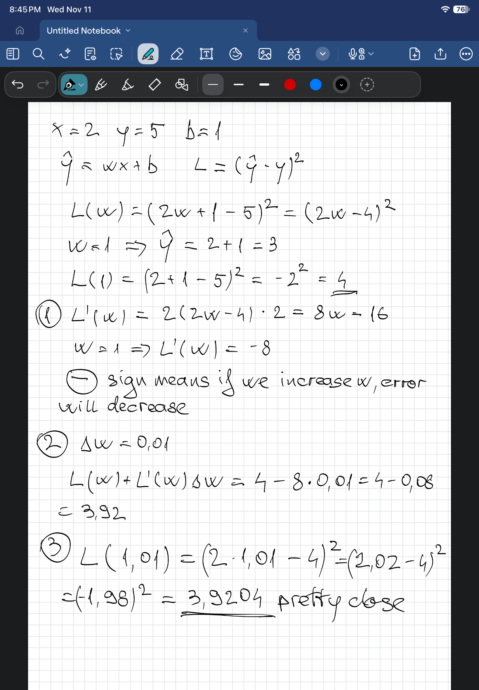
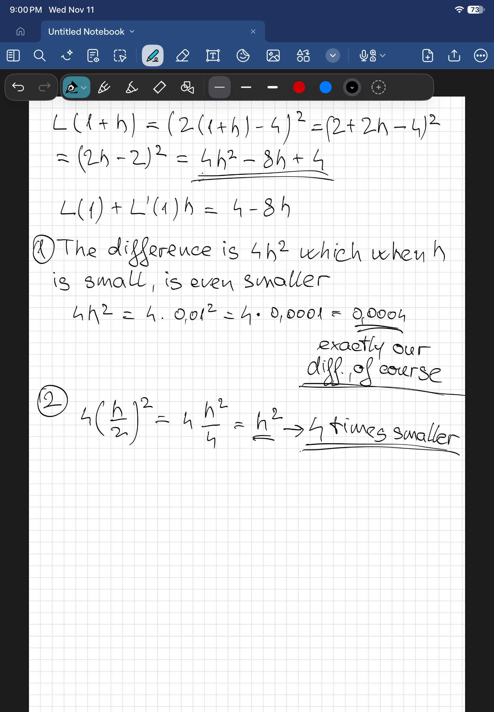
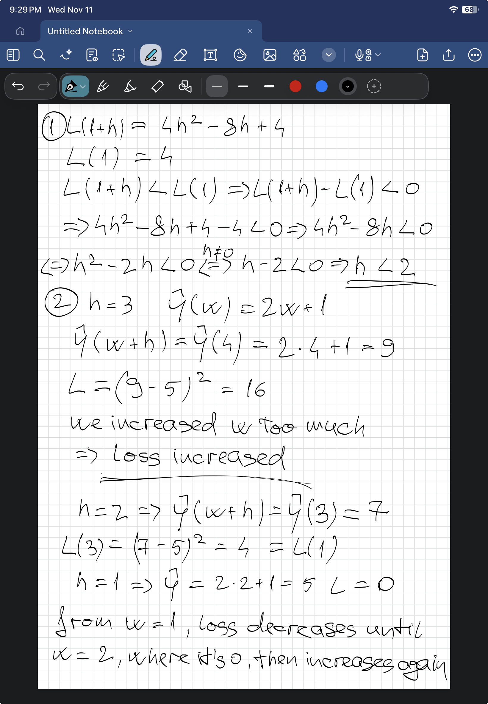
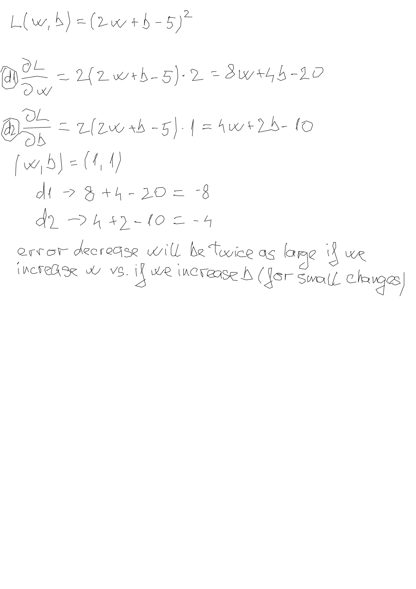
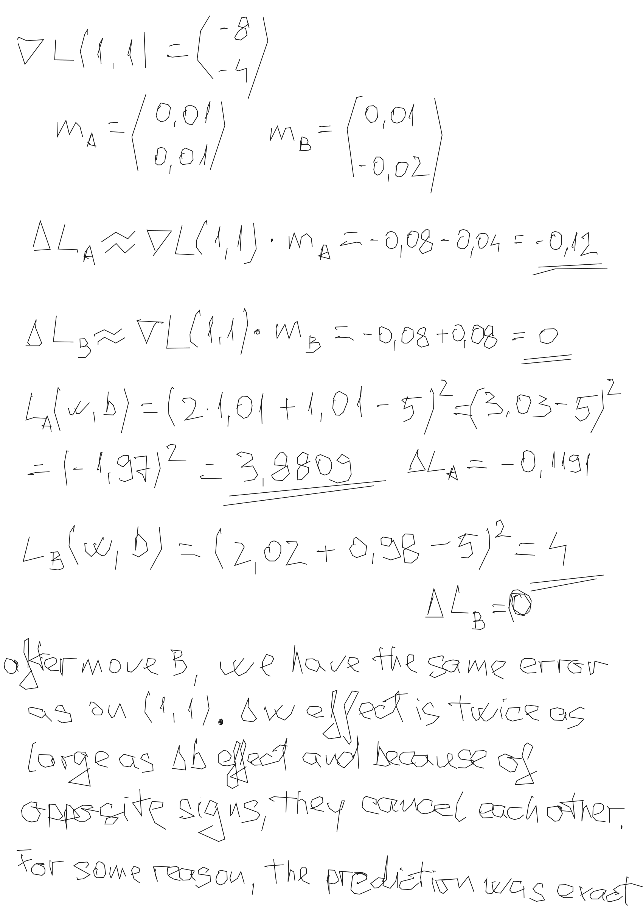
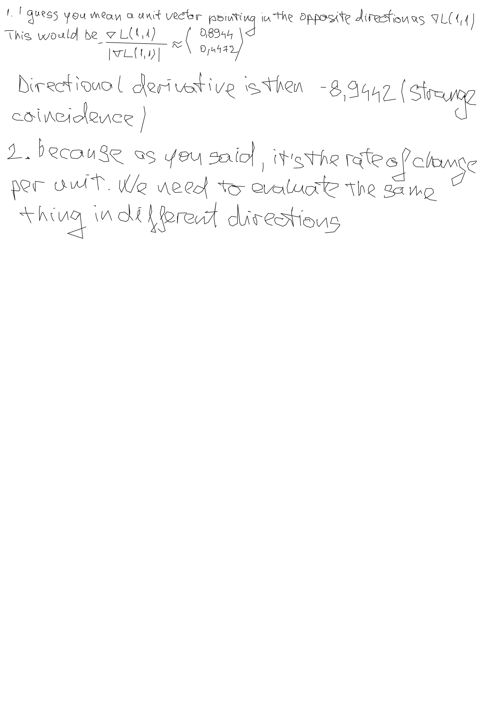
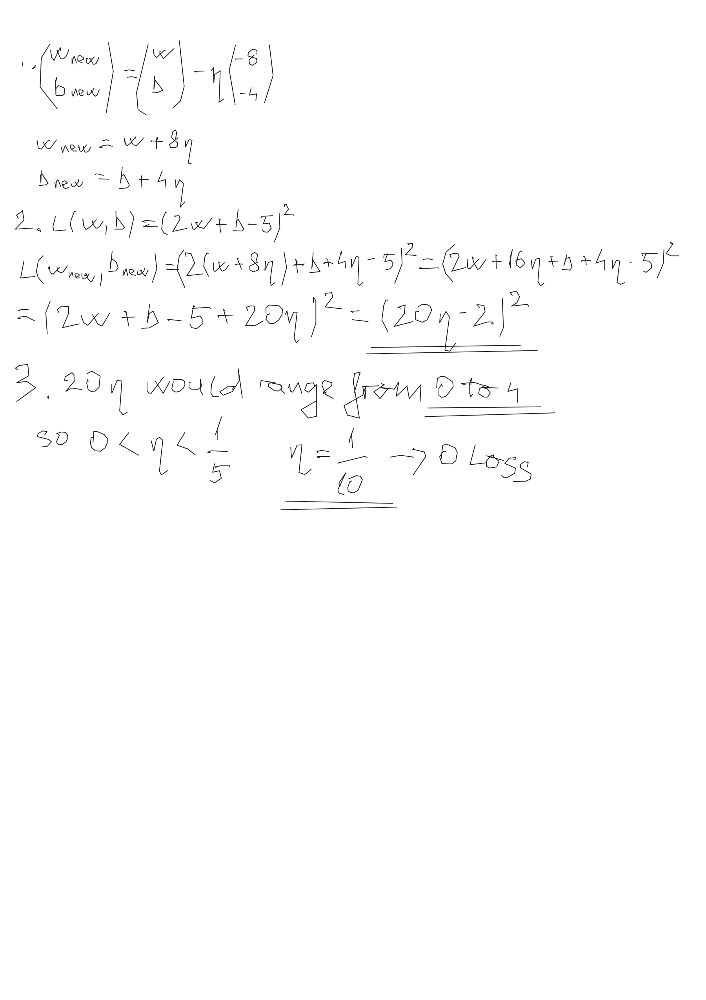

# Handwritten workbook

These pages preserve the calculations reviewed during the unit. The edited chapter explains the results and incorporates the notation corrections discussed along the way.

## Scalar derivative and the first approximation {#sec-work-scalar}

{height="125mm" .handwritten-figure}

## The approximation remainder {#sec-work-remainder}

{height="125mm" .handwritten-figure}

## Finite steps and overshoot {#sec-work-step}

{height="125mm" .handwritten-figure}

## Two partial derivatives {#sec-work-partials}

{height="125mm" .handwritten-figure}

## Simultaneous parameter changes {#sec-work-simultaneous}

{height="125mm" .handwritten-figure}

## The steepest unit direction {#sec-work-direction}

{height="125mm" .handwritten-figure}

## A gradient-descent update {#sec-work-update}

{height="125mm" .handwritten-figure}
