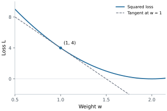
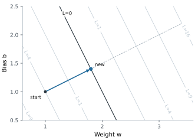

# Derivatives as predictions of local change

::: {.content-visible when-format="html"}

Milestone 1 · Unit 1 · Completed 12 November 2026

:::

The question for this unit is:

> How can a derivative tell us what will happen when we change a model parameter?

We will work with one small model throughout. That lets us compare a derivative's prediction with the exact answer, identify what the approximation leaves out, and connect the gradient to an actual learning update.

## The example

Take a single input and target:

$$
x=2,\qquad y=5.
$$

Our model predicts a number using a weight $w$ and a bias $b$:

$$
\hat y=wx+b.
$$

We measure its error with squared loss:

$$
L=(\hat y-y)^2.
$$

The input and target are data. The weight and bias are adjustable parameters. The prediction is the model's output, and the loss measures how far that output is from the target.

Initially, fix $b=1$ and vary only $w$. Then

$$
L(w)=(2w+1-5)^2=(2w-4)^2.
$$

At $w=1$, the prediction is $3$ and the loss is $4$.

## A derivative predicts a local change

The derivative is defined by

$$
f'(w)=\lim_{h\to0}\frac{f(w+h)-f(w)}{h}.
$$

For a small nonzero $h$, this suggests

$$
f(w+h)-f(w)\approx f'(w)h,
$$

or, equivalently,

$$
f(w+h)\approx f(w)+f'(w)h.
$$

The derivative is a rate of change. The estimated change in the function is that rate multiplied by the change in the parameter. Geometrically, the approximation uses the tangent line near its point of contact.

{#fig-local-linearization}

### Exercise 1: one adjustable weight

For $L(w)=(2w-4)^2$, starting at $w=1$:

1. Derive $L'(w)$, evaluate it at $w=1$, and interpret its sign.
2. Estimate the loss after increasing $w$ by $0.01$.
3. Calculate the exact new loss.

::: {.callout-note collapse="true" title="Worked solution"}
The chain rule gives

$$
L'(w)=2(2w-4)\cdot2=8w-16,
\qquad L'(1)=-8.
$$

A sufficiently small positive weight change therefore decreases the loss from this starting point.

The local approximation predicts

$$
L(1.01)\approx L(1)+L'(1)(0.01)
=4-8(0.01)=3.92.
$$

The exact calculation is

$$
L(1.01)=(2.02-4)^2=(-1.98)^2=3.9204.
$$

The discrepancy is $0.0004$.

When squaring a negative value, write $(-2)^2=4$. Under standard precedence, $-2^2$ means $-(2^2)=-4$.

:::

### Explain the discrepancy

Replace the specific step $0.01$ with an arbitrary step $h$. Expanding the exact expression gives

$$
\begin{aligned}
L(1+h)
&=(2(1+h)-4)^2\\
&=(2h-2)^2\\
&=4-8h+4h^2.
\end{aligned}
$$

The linear approximation keeps $4-8h$ and omits $4h^2$. At $h=0.01$, the omitted term is exactly $0.0004$.

Halving the step quarters this gap:

$$
4\left(\frac h2\right)^2=h^2=\frac14(4h^2).
$$

The important property is that the remainder shrinks faster than the step:

$$
\frac{|4h^2|}{|h|}=4|h|\longrightarrow0.
$$

Dividing the exact change by $h$ also recovers the derivative:

$$
\frac{L(1+h)-L(1)}{h}=-8+4h\longrightarrow-8.
$$

For a general differentiable function, the corresponding statement is

$$
f(w+h)=f(w)+f'(w)h+r(h),
\qquad
\frac{r(h)}{h}\longrightarrow0.
$$

The exact remainder $4h^2$ belongs to our particular quadratic example. Differentiability alone does not require every function to have this same quadratic remainder.

### A useful direction can still produce an excessive step

The negative derivative at $w=1$ tells us what happens locally. To find which positive steps actually improve this loss, use the exact expression:

$$
\begin{aligned}
L(1+h)<L(1)
&\iff 4-8h+4h^2<4\\
&\iff 4h(h-2)<0.
\end{aligned}
$$

For positive $h$, the result is

$$
0<h<2.
$$

Dividing an inequality by $h$ preserves its direction here because $h>0$. Merely knowing that $h$ is nonzero would not be sufficient.

The minimum is at $h=1$, corresponding to the new weight $w=2$. At $h=2$, the new weight is $3$ and the loss has returned to $4$. At $h=3$, the new weight is $4$ and the loss is $16$.

The tangent-line prediction for that last step would be

$$
4-8(3)=-20.
$$

The squared loss itself cannot be negative. The negative estimate shows that we have extrapolated the local approximation too far.

## Let both parameters vary

Restore the variable bias. The loss is now a function of two parameters:

$$
L(w,b)=(2w+b-5)^2.
$$

A partial derivative varies one parameter while holding the other fixed.

### Exercise 2: two local sensitivities

Derive $\partial L/\partial w$ and $\partial L/\partial b$, then evaluate them at $(w,b)=(1,1)$. Compare equal small positive changes applied to each parameter separately.

::: {.callout-note collapse="true" title="Worked solution"}
Holding $b$ fixed gives

$$
\frac{\partial L}{\partial w}
=2(2w+b-5)\cdot2
=8w+4b-20.
$$

Holding $w$ fixed gives

$$
\frac{\partial L}{\partial b}
=2(2w+b-5)\cdot1
=4w+2b-10.
$$

At the starting point,

$$
\frac{\partial L}{\partial w}(1,1)=-8,
\qquad
\frac{\partial L}{\partial b}(1,1)=-4.
$$

Increasing either parameter alone by a sufficiently small positive amount decreases the loss locally. For equal small changes, the first-order decrease from changing $w$ is twice that from changing $b$.

The phrase "first-order" matters: this is a comparison of local sensitivities, not a promise of an exact ratio for arbitrary finite changes.

:::

## The gradient collects those sensitivities

With the parameter order fixed as $(w,b)$, define the gradient:

$$
\nabla L=
\begin{pmatrix}
\partial L/\partial w\\
\partial L/\partial b
\end{pmatrix}.
$$

At the starting point,

$$
\nabla L(1,1)=\begin{pmatrix}-8\\-4\end{pmatrix}.
$$

For a small simultaneous change

$$
\Delta\theta=\begin{pmatrix}\Delta w\\\Delta b\end{pmatrix},
$$

the multivariable local approximation is

$$
\Delta L\approx
\nabla L(1,1)\cdot\Delta\theta
=-8\Delta w-4\Delta b.
$$

The dot product adds each parameter's sensitivity multiplied by its change.

### Exercise 3: simultaneous changes

Starting from $(1,1)$, where $L=4$, compare:

| Move | $\Delta w$ | $\Delta b$ |
|---|---:|---:|
| A | $+0.01$ | $+0.01$ |
| B | $+0.01$ | $-0.02$ |

For each move, predict the loss change using the gradient, then calculate the exact new loss. Explain move B through the prediction $2w+b$.

::: {.callout-note collapse="true" title="Worked solution"}
The first-order predictions are

$$
\Delta L_A\approx-8(0.01)-4(0.01)=-0.12
$$

and

$$
\Delta L_B\approx-8(0.01)-4(-0.02)=0.
$$

The exact results are:

| Move | New parameters | New loss | Exact loss change |
|---|---|---:|---:|
| A | $(1.01,1.01)$ | $3.8809$ | $-0.1191$ |
| B | $(1.01,0.98)$ | $4$ | $0$ |

Move B leaves the model prediction exactly unchanged:

$$
\Delta\hat y=2\Delta w+\Delta b
=2(0.01)-0.02=0.
$$

Its residual and loss are therefore unchanged as well. This explains why the zero-change approximation happens to be exact here.

For move A, the prediction changes by $0.03$. Expanding the squared residual adds $(0.03)^2=0.0009$ to the first-order estimate, giving $-0.12+0.0009=-0.1191$.

A zero gradient dot product generally means zero first-order change. Exact equality for a finite step needs more information about the function.

:::

## Directional derivatives and the steepest direction

To compare directions fairly, separate direction from distance. Let $u$ be a unit vector and move by $\Delta\theta=tu$, where $t>0$ is the distance.

Then

$$
\Delta L\approx t\,\nabla L\cdot u.
$$

The directional derivative is the local rate of loss change per unit distance in direction $u$:

$$
D_uL(\theta)=
\left.\frac{d}{dt}L(\theta+tu)\right|_{t=0}
=\nabla L(\theta)\cdot u.
$$

### Exercise 4: the most negative directional derivative

At $(1,1)$, find the unit vector $u$ minimizing $\nabla L(1,1)\cdot u$. Calculate that minimum value and explain why the unit-length constraint matters.

::: {.callout-note collapse="true" title="Worked solution and geometric justification"}
Write $g=\nabla L(1,1)$. If $\phi$ is the angle between $g$ and a unit vector $u$, then

$$
g\cdot u=\|g\|\|u\|\cos\phi=\|g\|\cos\phi.
$$

The smallest possible cosine is $-1$, so the minimizing direction is opposite the gradient:

$$
u_*=-\frac{g}{\|g\|}
=\frac{(8,4)^{\mathrm T}}{\sqrt{80}}
=\frac{(2,1)^{\mathrm T}}{\sqrt5}
\approx
\begin{pmatrix}0.8944\\0.4472\end{pmatrix}.
$$

The minimum directional derivative is

$$
-\|g\|=-\sqrt{80}=-4\sqrt5\approx-8.94427.
$$

The match between the gradient norm and the magnitude of this rate is an identity, not a numerical coincidence.

Fixing the length isolates direction. Without that constraint, multiplying a descent vector by larger positive factors makes its dot product with $g$ arbitrarily negative.

This steepest-direction statement uses Euclidean distance and a nonzero gradient.

:::

## From a direction to a learning update

Basic gradient descent uses

$$
\theta_{\mathrm{new}}
=\theta-\eta\nabla L(\theta),
\qquad\eta>0.
$$

The scalar $\eta$ is the learning rate. The update follows the negative gradient, with step length $\eta\|\nabla L(\theta)\|$.

### Exercise 5: choose the learning rate

Starting from $(w,b)=(1,1)$ with gradient $(-8,-4)^{\mathrm T}$:

1. Write the updated parameters as functions of $\eta$.
2. Obtain the exact new loss.
3. Find the positive learning rates that improve on loss $4$, and the rate that minimizes the new loss.

::: {.callout-note collapse="true" title="Worked solution"}
The update is

$$
w_{\mathrm{new}}=1+8\eta,\qquad
b_{\mathrm{new}}=1+4\eta.
$$

Substitution gives

$$
\begin{aligned}
L_{\mathrm{new}}
&=\big(2(1+8\eta)+(1+4\eta)-5\big)^2\\
&=(20\eta-2)^2.
\end{aligned}
$$

Improvement requires

$$
(20\eta-2)^2<4
\iff -2<20\eta-2<2
\iff 0<\eta<\frac15.
$$

The minimum occurs when $20\eta-2=0$, hence

$$
\eta_*=\frac1{10}.
$$

This gives $(w_{\mathrm{new}},b_{\mathrm{new}})=(1.8,1.4)$, prediction $5$, and loss $0$.

At $\eta=0.2$, the loss returns to $4$. Larger positive rates make it exceed the starting loss. These bounds belong to this particular example, not to all training problems.

:::

### Explore the loss geometry

Each contour joins parameter settings with the same loss. The update path starts at $(1,1)$ and moves in the negative-gradient direction. Change the learning rate to see the path reach the minimum and then overshoot.

::: {.content-visible when-format="html"}
~~~{=html}
<iframe class="interactive-frame" src="../assets/loss-surface.html" title="Interactive gradient-descent loss contours" loading="lazy"></iframe>

The slider changes the learning rate for one update from the fixed starting point.

~~~
:::

::: {.content-visible unless-format="html"}
{#fig-loss-contours}

The interactive version is available in the [online coursebook](https://dragos-fotache.github.io/llm-coursebook/units/01-local-change.html).
:::

The zero-loss settings satisfy $2w+b=5$. There is a whole line of parameter pairs fitting this one training example. Our update reaches $(1.8,1.4)$; the earlier weight-only calculation reached $(2,1)$. Both predict $5$.

## Keep these distinctions clear

- A derivative is a local rate; a finite change also depends on step size.
- A partial derivative holds the other parameters fixed.
- The gradient collects partial derivatives in a consistent parameter order.
- A gradient dot product predicts a first-order loss change.
- A zero directional derivative does not generally imply exact constancy along a finite move.
- The negative gradient is steepest for a Euclidean unit-length comparison.
- The learning rate scales the gradient; it is not generally the update's actual distance.

## Unit checkpoint

The five exercises establish the ability to differentiate this loss, predict and verify small changes, reason about approximation error and overshoot, combine parameter changes, and derive a controlled gradient-descent update.

The next unit turns these calculations into computational graphs. We will track dependencies, apply local derivative rules, and see why contributions from shared paths must be added.
