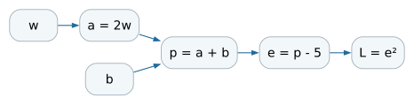
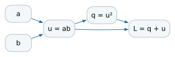
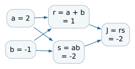

# Computational graphs and the multivariable chain rule

::: {.content-visible when-format="html"}

Milestone 1 · Unit 2 · Completed 13 November 2026

:::

In unit 1, we used gradients to predict changes in loss and choose a parameter update. This unit focuses on how to calculate those gradients systematically:

> How can we compute a loss gradient by following the operations that produced the loss?

We will work with scalar computations throughout. The central procedure is to evaluate a graph forward, then propagate derivatives backward. When a value influences the output through several paths, all those paths contribute.

## From an expression to a graph

Return to the familiar model with fixed input $x=2$ and target $y=5$:

$$
L(w,b)=(2w+b-5)^2.
$$

Name each intermediate result:

$$
a=2w,\qquad p=a+b,\qquad e=p-5,\qquad L=e^2.
$$

Here $p$ is the prediction and $e$ is its signed error. Each assignment performs one operation. An arrow in the graph means that an operation uses a value as an input; the constants $2$ and $5$ are included in the operation labels.

{#fig-computational-chain}

The **forward pass** evaluates these operations in dependency order. At $(w,b)=(1,1)$:

| Quantity | Calculation | Value |
|---|---|---:|
| $a$ | $2w$ | $2$ |
| $p$ | $a+b$ | $3$ |
| $e$ | $p-5$ | $-2$ |
| $L$ | $e^2$ | $4$ |

## Local derivatives and derivatives of the loss

A **local derivative** describes one operation, holding its other inputs fixed. For the addition $p=a+b$,

$$
\frac{\partial p}{\partial a}=1,
\qquad
\frac{\partial p}{\partial b}=1.
$$

The derivative $\partial L/\partial a$ answers a different question: how does changing $a$ affect the final loss through the downstream operations $p$, $e$, and $L$?

This graph has the following local rules:

| Operation | Local derivative |
|---|---|
| $a=2w$ | $\partial a/\partial w=2$ |
| $p=a+b$ | $\partial p/\partial a=1$, $\partial p/\partial b=1$ |
| $e=p-5$ | $\partial e/\partial p=1$ |
| $L=e^2$ | $\partial L/\partial e=2e$ |

The square's derivative depends on its current input. At $e=-2$, it is $-4$. The forward values therefore supply information needed by the backward calculation.

### Why derivatives multiply along a chain

Suppose $z=f(v)$ and $L=g(z)$. For small changes,

$$
\Delta z\approx f'(v)\Delta v,
$$

and consequently

$$
\Delta L\approx g'(z)\Delta z
\approx g'(z)f'(v)\Delta v.
$$

The resulting rate of change is the chain rule:

$$
\frac{dL}{dv}=\frac{dL}{dz}\frac{dz}{dv}.
$$

Each factor describes one link in the dependency chain. Multiplication composes the local rates.

### Exercise 1: trace the loss derivatives backward

For the graph above, at $(w,b)=(1,1)$, calculate

$$
\frac{\partial L}{\partial p},\qquad
\frac{\partial L}{\partial a},\qquad
\frac{\partial L}{\partial w},\qquad
\frac{\partial L}{\partial b}.
$$

Show the chain-rule products. Explain why $\partial p/\partial a$ and $\partial L/\partial a$ can have different values.

::: {.callout-note collapse="true" title="Worked solution"}
Begin with the final operation:

$$
\frac{\partial L}{\partial e}=2e=-4.
$$

Moving backward gives

$$
\frac{\partial L}{\partial p}
=\frac{\partial L}{\partial e}\frac{\partial e}{\partial p}
=(-4)(1)=-4,
$$

$$
\frac{\partial L}{\partial a}
=\frac{\partial L}{\partial p}\frac{\partial p}{\partial a}
=(-4)(1)=-4,
$$

$$
\frac{\partial L}{\partial w}
=\frac{\partial L}{\partial a}\frac{\partial a}{\partial w}
=(-4)(2)=-8,
$$

$$
\frac{\partial L}{\partial b}
=\frac{\partial L}{\partial p}\frac{\partial p}{\partial b}
=(-4)(1)=-4.
$$

Thus we recover the unit 1 parameter gradient, $\nabla L(1,1)=(-8,-4)^{\mathrm T}$.

The local derivative $\partial p/\partial a=1$ describes the immediate effect on the prediction. The derivative $\partial L/\partial a=-4$ includes everything downstream: a small increase in $a$ raises the prediction and locally lowers the squared loss at this point. The derivatives describe different dependencies; their numerical values may coincide in other examples.
:::

## A shared value creates multiple paths

Consider

$$
u=ab,\qquad q=u^2,\qquad L=q+u.
$$

{#fig-shared-intermediate}

There are two paths from $u$ to $L$:

$$
u\longrightarrow q\longrightarrow L,
\qquad
u\longrightarrow L.
$$

Changing $u$ changes both inputs to the final addition. We must include both effects.

### Why the path contributions add

Write the final operation as $L=F(q,s)$, with $q=q(u)$ and $s=s(u)$. Unit 1's gradient approximation gives

$$
\Delta L\approx
\frac{\partial F}{\partial q}\Delta q
+\frac{\partial F}{\partial s}\Delta s.
$$

Substituting the local changes in $q$ and $s$ gives

$$
\Delta L\approx
\left(
\frac{\partial F}{\partial q}\frac{dq}{du}
+\frac{\partial F}{\partial s}\frac{ds}{du}
\right)\Delta u.
$$

Hence the multivariable chain rule is

$$
\frac{dL}{du}
=\frac{\partial F}{\partial q}\frac{dq}{du}
+\frac{\partial F}{\partial s}\frac{ds}{du}.
$$

Each partial derivative of $F$ holds its other input fixed. The total derivative $dL/du$ includes both inputs' responses to $u$.

Geometrically, decompose the displacement in the final operation's input plane:

$$
(\Delta q,\Delta s)=(\Delta q,0)+(0,\Delta s).
$$

The tangent plane's predicted change in height is linear in this displacement, so the two signed height changes add. Contributions can have opposite signs and cancel.

The rule is: **multiply local derivatives along each path, then add the contributions from the different paths.**

### Exercise 2: a shared intermediate value

For $u=ab$, $q=u^2$, $L=q+u$, start at $a=2$, $b=3$.

1. Calculate $u,q,L$.
2. Find the total derivative $dL/du$, showing both path contributions.
3. Calculate $\partial L/\partial a$ and $\partial L/\partial b$.

::: {.callout-note collapse="true" title="Worked solution"}
The forward values are

$$
u=6,\qquad q=36,\qquad L=42.
$$

Make the identity branch explicit by defining $s(u)=u$. Then $L=F(q,s)=q+s$, with local derivatives

$$
\frac{\partial F}{\partial q}=1,
\qquad
\frac{\partial F}{\partial s}=1.
$$

The two branch derivatives are

$$
\frac{dq}{du}=2u=12,
\qquad
\frac{ds}{du}=1.
$$

Adding the path contributions gives

$$
\frac{dL}{du}=(1)(12)+(1)(1)=13.
$$

Propagate this accumulated derivative through $u=ab$:

$$
\frac{\partial L}{\partial a}
=\frac{dL}{du}\frac{\partial u}{\partial a}
=13b=39,
$$

$$
\frac{\partial L}{\partial b}
=\frac{dL}{du}\frac{\partial u}{\partial b}
=13a=26.
$$

In this example, $F(q,s)=q+s$ is itself a plane, so $\Delta L=\Delta q+\Delta s$ is exact for finite changes in its inputs. The overall composite function $L(u)=u^2+u$ remains nonlinear because $q(u)$ is nonlinear.
:::

## Signed contributions and cancellation

The same rule applies when the final operation is a multiplication. Its two local derivatives depend on its inputs, and contributions can cancel even when both paths are active.

### Exercise 3: set up an unfamiliar graph

Let

$$
r=a+b,\qquad s=ab,\qquad J=rs,
$$

with $a=2$, $b=-1$. Here $J$ is a scalar output.

1. Draw the graph and annotate forward values and local derivatives.
2. Calculate $\partial J/\partial a$ and $\partial J/\partial b$, showing the path contributions separately.
3. If a derivative is zero, does that imply independence of the corresponding variable?

::: {.callout-note collapse="true" title="Worked solution"}
The forward values are $r=1$, $s=-2$, and $J=-2$.

{#fig-two-paths}

The local derivatives are

$$
\frac{\partial J}{\partial r}=s=-2,
\qquad
\frac{\partial J}{\partial s}=r=1,
$$

$$
\frac{\partial r}{\partial a}=1,
\qquad
\frac{\partial r}{\partial b}=1,
$$

$$
\frac{\partial s}{\partial a}=b=-1,
\qquad
\frac{\partial s}{\partial b}=a=2.
$$

For $a$, sum the contributions through $r$ and $s$:

$$
\begin{aligned}
\frac{\partial J}{\partial a}
&=\frac{\partial J}{\partial r}\frac{\partial r}{\partial a}
+\frac{\partial J}{\partial s}\frac{\partial s}{\partial a}\\
&=(-2)(1)+(1)(-1)=-3.
\end{aligned}
$$

For $b$, the two contributions cancel:

$$
\begin{aligned}
\frac{\partial J}{\partial b}
&=\frac{\partial J}{\partial r}\frac{\partial r}{\partial b}
+\frac{\partial J}{\partial s}\frac{\partial s}{\partial b}\\
&=(-2)(1)+(1)(2)=0.
\end{aligned}
$$

The tangent plane to $J(a,b)$ at this point is horizontal in the $b$ direction. This is a local statement: it does not imply that $J$ is independent of $b$.

Holding $a=2$ gives

$$
J(2,b)=(2+b)(2b)=4b+2b^2.
$$

Consequently,

$$
J(2,-1+h)=-2+2h^2.
$$

The first-order term vanishes, while every nonzero $h$ changes the output in this example.
:::

## A neuron with a nonlinear activation

Use one scalar neuron with fixed input $x$ and target $y$, and trainable parameters $w,b$:

$$
m=wx,\qquad z=m+b,\qquad p=\tanh z,
$$

$$
e=p-y,\qquad L=e^2.
$$

The activation $\tanh$ makes the prediction nonlinear in the weighted sum $z$. Its output lies in $(-1,1)$:

$$
\tanh z=\frac{\exp(2z)-1}{\exp(2z)+1}.
$$

### Derive the activation's local rule

Set $t=\exp(2z)$, so $dt/dz=2t$. Applying the quotient rule gives

$$
\begin{aligned}
\frac{dp}{dz}
&=\frac{2t(t+1)-2t(t-1)}{(t+1)^2}\\
&=\frac{4t}{(t+1)^2}\\
&=1-\left(\frac{t-1}{t+1}\right)^2\\
&=1-p^2.
\end{aligned}
$$

The backward rule can therefore reuse the activation output stored during the forward pass.

### Exercise 4: backpropagate through the neuron

Take

$$
x=2,\qquad y=0,\qquad w=\tfrac12,\qquad b=0.
$$

1. Draw the graph and calculate $m,z,p,e,L$.
2. Derive $\partial L/\partial z$, $\partial L/\partial w$, and $\partial L/\partial b$ symbolically, then evaluate them numerically.
3. Identify the activation's factor in the backward calculation. What happens to it as $|z|$ becomes large?

::: {.callout-note collapse="true" title="Worked solution"}
The forward values are

| Quantity | Value |
|---|---:|
| $m=wx$ | $1$ |
| $z=m+b$ | $1$ |
| $p=\tanh z$ | $\approx0.761594$ |
| $e=p-y$ | $\approx0.761594$ |
| $L=e^2$ | $\approx0.580026$ |

The signed error $e$ and squared loss $L$ are distinct intermediate values. The square contributes the local derivative $\partial L/\partial e=2e$.

Apply the chain rule through the error and activation:

$$
\begin{aligned}
\frac{\partial L}{\partial z}
&=\frac{\partial L}{\partial e}
\frac{\partial e}{\partial p}\frac{dp}{dz}\\
&=2e\cdot1\cdot(1-p^2)\\
&=2(p-y)(1-p^2).
\end{aligned}
$$

At the specified point, the local factors are

$$
2e\approx1.523188,
\qquad 1-p^2\approx0.419974,
$$

so

$$
\frac{\partial L}{\partial z}\approx0.639700.
$$

Continue through the affine computation, holding $x,y$ fixed:

$$
\begin{aligned}
\frac{\partial L}{\partial w}
&=\frac{\partial L}{\partial z}
\frac{\partial z}{\partial m}\frac{\partial m}{\partial w}\\
&=2(p-y)(1-p^2)x\\
&\approx1.279400,
\end{aligned}
$$

$$
\begin{aligned}
\frac{\partial L}{\partial b}
&=\frac{\partial L}{\partial z}\frac{\partial z}{\partial b}\\
&=2(p-y)(1-p^2)\\
&\approx0.639700.
\end{aligned}
$$

The activation contributes the multiplier $1-p^2=1-\tanh^2 z$. Its two limits are

$$
z\to+\infty:\quad \tanh z\to+1,
$$

$$
z\to-\infty:\quad \tanh z\to-1.
$$

In both cases $\tanh^2 z\to1$, hence

$$
1-\tanh^2 z\longrightarrow0.
$$

This is **activation saturation**: the activation becomes nearly flat and supplies a small multiplier to the incoming loss derivative.
:::

## The backward procedure

The examples share a single procedure:

1. Evaluate operations in dependency order and retain their forward values.
2. Start at the scalar output, whose derivative with respect to itself is $1$.
3. Work backward. Multiply the derivative arriving at an operation by each input's local derivative.
4. Add contributions whenever an input is used more than once. Include every input use, even if the same value occupies both inputs of one operation.
5. Propagate an intermediate value's accumulated derivative once all its downstream contributions are available.

This calculates gradients. Updating parameters using those gradients is a separate step, such as the gradient-descent update from unit 1.

## Unit checkpoint

You should now be able to draw a small computational graph, evaluate it, distinguish local and final-output derivatives, and derive its backward calculation. You should also be able to explain why paths multiply internally, why separate path contributions add, and why their cancellation at one point does not establish independence.

The next unit turns this procedure into a small scalar reverse-mode automatic-differentiation engine in Python.

For a complementary treatment, see *Dive into Deep Learning*, section 5.3, in the [reading references](../reference.qmd#computational-graphs-and-backpropagation).
